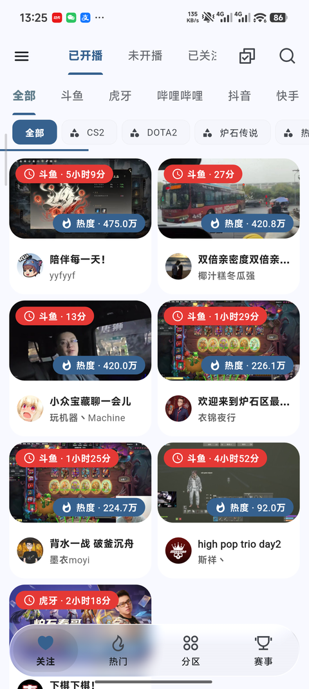
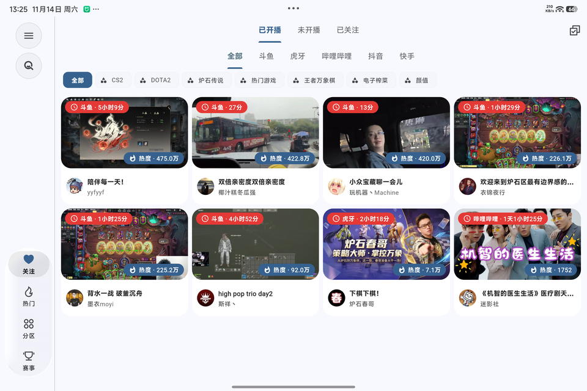
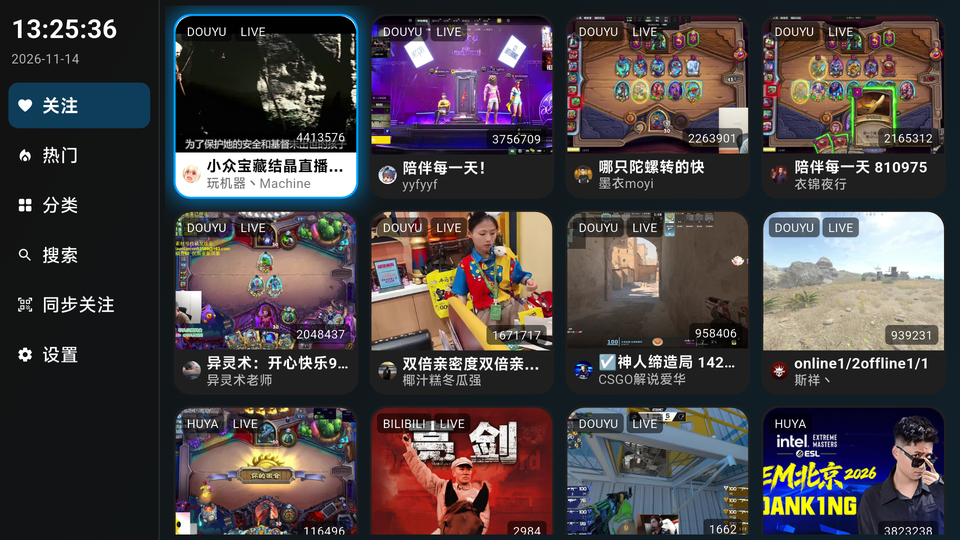

<p align="center">
  
</p>

<p align="center">
  <b>五平台直播聚合，一套 APK 三端自适应。</b><br>
  手机竖屏、平板侧栏、电视遥控器 UI 自动切换；手机、平板、电视之间一键互传关注与登录态；
  再配一套 NAS / 云服务器上的 Web 服务端，浏览器里也有完整的观看体验。
</p>

<p align="center">
  <a href="https://github.com/superxyline/purelive/releases/latest"><b>下载安装</b></a> ·
  <a href="#快速开始"><b>快速开始</b></a> ·
  <a href="#功能列表"><b>功能列表</b></a> ·
  <a href="#服务端部署-nas--云服务器--windows-电脑"><b>服务端部署</b></a> ·
  <a href="#常见问题"><b>常见问题</b></a> ·
  <a href="https://github.com/liuchuancong/pure_live"><b>上游仓库</b></a> ·
  <a href="https://gitee.com/superxyline/purelive">Gitee 镜像</a>
</p>

<p align="center">
  <a href="https://github.com/superxyline/purelive/releases/latest"></a>
  <a href="https://github.com/superxyline/purelive/releases"></a>
  
  
  
  <a href="https://github.com/superxyline/purelive/stargazers"></a>
</p>

<table>
  <tr>
    <td width="33%" valign="top">
      <b>一套 APK，三端自适应</b><br>
      启动自动检测设备形态：电视进大屏遥控器 UI、平板进侧边栏布局、手机进竖屏触屏界面，无需手动配置。
    </td>
    <td width="33%" valign="top">
      <b>三端互推，免扫码</b><br>
      手机 / 平板 / 电视自动发现同一 Wi-Fi 下的 PureLive 设备，一键互传关注与登录态；接收端确认后按并集合并，已有的不重复。
    </td>
    <td width="33%" valign="top">
      <b>液态玻璃导航</b><br>
      自写 fragment shader 的浮动玻璃胶囊导航：边缘折射、弹簧水滴选中、按住变放大镜、底栏拖拽换页。
    </td>
  </tr>
</table>

<p align="center">
  <a href="preview_image/phone.png"></a>
  <a href="preview_image/pad.png"></a>
  <a href="preview_image/tv.png"></a>
</p>

<p align="center">
  <sub>左：手机竖屏关注页（液态玻璃底栏） · 中：平板横屏侧边栏 · 右：电视遥控器 UI</sub>
</p>

## 与原版相比的核心变化

| 项目 | 原版 pure_live | 自用修改版（纯净版） |
| --- | --- | --- |
| 目标平台 | Android / Windows / Linux / macOS / iOS | 仅 Android（arm / arm64 / x86_64，三端界面自适应） |
| 直播平台 | 30+ 平台 | 聚焦哔哩哔哩 / 斗鱼 / 虎牙 / 抖音 / 快手 |
| 电视端 | 无 | 大屏遥控器 UI + 弹幕飘屏 + 扫码/互推同步 |
| 跨端同步 | 无 | WebDAV + 扫码一键同步 + NAS 常连同步 + **三端局域网互推** |
| 赛事中心 | 无 | CS / LOL / VALORANT 赛程赛果与关注 |
| 醒目留言 | 无 | B站 SC 卡片 + 全屏弹窗 + 虎牙醒目留言 |
| 真实发弹幕 | 仅本地回显 | B站登录后真实发送 |
| 双开 / 副音轨 | 无 | 双窗口对比观看；副音轨听解说 |
| 本地互动 | 无 | 本地资料、礼物、等级经验（金豆无限制） |
| 本地数据加密 | 明文 | AES + 系统密钥加密 |
| 液态玻璃导航 | 无 | 浮动玻璃胶囊 + 弹簧水滴 + 折射 shader |
| 播放稳定性 | 基础 | 斗鱼 5 分钟踢线无缝续流、断流 EOS 秒级自愈、播放中停摆自愈、B站三层取流兜底 |

## 快速开始

### 前置条件

- Android 7.0+ 设备（手机 / 平板 / 安卓电视盒子均可）；
- CPU：`arm64-v8a`（手机 / 平板）/ `armeabi-v7a`（电视）/ `x86_64`（模拟器）；
- 想在浏览器里看直播：任意能跑 Docker 的 NAS / 云服务器 / Windows 电脑（见[服务端部署](#服务端部署-nas--云服务器--windows-电脑)，可选）。

### 安装

从 [GitHub Releases](https://github.com/superxyline/purelive/releases/latest)（国内可用 [Gitee Releases](https://gitee.com/superxyline/purelive/releases)）按设备下载对应包：

| 安装包 | 适合设备 |
| --- | --- |
| `PureLive-v<版本>-arm64-v8a.apk` | 手机 / 平板（主流 64 位设备） |
| `PureLive-v<版本>-armeabi-v7a.apk` | 安卓电视 / 老设备（32 位） |
| `PureLive-v<版本>-x86_64.apk` | 模拟器 |

直接安装覆盖升级，数据（关注 / 登录态 / 设置）全部保留。

- 首次使用：首页页签选平台 → 「账号」登录对应平台（B站 / 斗鱼 / 虎牙 / 抖音 / 快手网页登录），未登录也能看大部分直播；
- **电视 / 盒子**：启动即大屏遥控器 UI，配合「扫码同步」或「局域网互推」把手机的关注与登录态传过去；
- NAS / 云服务器 / Windows 便携版的 Web 服务端部署见[下文](#服务端部署-nas--云服务器--windows-电脑)。

### 自编译

```bash
git clone https://gitee.com/superxyline/purelive.git && cd purelive
flutter pub get
flutter analyze --no-pub                                  # 构建门禁：lib/ 零 error
flutter build apk --release --target-platform android-arm64
```

| 依赖 | 版本要求 | 说明 |
| --- | --- | --- |
| Flutter SDK | 3.x（实测 3.47.0） | [flutter.dev](https://flutter.dev) 或国内镜像 |
| Android SDK | cmdline-tools + API 34+ | Android Studio 或 `sdkmanager` |
| JDK | 17+ | AGP 要求 |

- 产物在 `build/app/outputs/flutter-apk/`；单架构构建产物为 `app-release.apk`，多架构带 ABI 后缀；
- 电视（32 位）构建：`flutter build apk --release --target-platform android-arm -PtargetAbi=armeabi-v7a`；
- Gradle 下载慢：仓库提供 `tool/gradle-cn-mirrors.init.gradle` 国内镜像脚本，配合 `--init-script` 使用；
- 改动 `lib/` 后提交前请重跑 analyze + 构建双验证，避免启动崩溃类回归。

## 功能列表

本仓库是 [pure_live](https://github.com/liuchuancong/pure_live)（AGPL-3.0）的个人自用修改版，专注 Android 三端。以下按模块列出二开新增与增强（括号内为引入版本）。

### 多端适配与导航

- **电视模式**【v2.6.0】：电视 / 盒子启动即大屏遥控器 UI（大字号焦点高亮 + 索引导航、完整遥控键位、自研弹幕飘屏、播放兼容模式开关），手机 / 平板界面零改动；
- **液态玻璃导航**【v2.6.1】：手机底部导航与平板侧栏切换为浮动玻璃胶囊——fragment shader 边缘折射（厚透镜）、弹簧水滴选中（拉伸变形 / 按住放大镜）、手机底栏按住拖拽滑动换页（橡皮筋阻尼 + 触觉反馈）；shader 不可用时三级降级（磨砂 → 纯色）；
- 横竖屏适配【v2.2.0】：平板恒横屏，手机全屏 / 竖屏智能切换（可跟随直播源）；
- 全屏几何过渡【v2.4.0】：全屏 / 非全屏互切时画面按流真实比例几何放大缩回，多次连续切换不累积偏移；
- 背景与壁纸：纯色 / 渐变 / 本地图片 / 在线壁纸 / 本地与网络视频动态壁纸，暗化遮罩与高斯模糊可调，直播播放期间自动让出解码器；
- 导航自定义：底部页签排序显隐自由配置；页签双击刷新；
- 重力感应自动全屏：横屏直播间横持转竖持自动退出全屏，可关。

### 直播观看

- 五平台聚合：哔哩哔哩 / 斗鱼 / 虎牙 / 抖音 / 快手，页签选中色跟随平台品牌色；
- 取流画质对齐【v2.2.1】：各平台取流参数、签名与 UA 对齐官方网页（B站 WBI 签名 / 斗鱼 ub98484234 / 抖音 a-bogus / 虎牙 anticode），按服务端实际档位选线路；
- B站取流三层兜底【v2.3.1】：WBI 签名 → 免签名参数 → 服务端最高档，不再「首页能刷、点进去全部读取失败」；
- 斗鱼原画无缝续流【v2.3.0】：本地 FLV 中继在 5 分钟踢线到期前预签接流，播放器看到一条连续流；
- 断流 EOS 秒级自愈：CDN 断流 0.25 秒自动换流、停摆 8 秒换线、卡缓冲 12 秒换线、连换 4 次才报错；连接 4 分钟后主动预签下一批地址；
- 播放容错：HEVC 无画面线路自动后置、7 秒无画面自动换线；登录态降档提醒；
- Anime4K 超分、直播缓冲调节、loudnorm 音量均衡、双指缩放画面、一键临时静音、画面遮挡块（模糊框遮广告）、直播间信息 OSD、CDN 测速排序；
- 虎牙未登录回退：风控「未开播」场景自动以隐藏 WebView 取回真实开播状态。

### 弹幕系统

- 弹幕深度定制：模板、位置、样式、速度、描边、透明度、字体、互动手势；礼物卡片 8 方位；
- 弹幕大帧解码移出 UI 线程【v2.6.1】：B站 / 斗鱼 / 抖音解压与协议解析进独立 isolate（串行队列保序 + 16 MiB 积压熔断 + 失败回退同步），高峰期不再挤占界面线程；
- 弹幕回看：上滑看历史弹幕，10 秒无操作自动回底；程序滚动不误判为用户操作；
- 弹幕屏蔽：普通词 / 正则 / 通配符 / 智能分词选择 / 屏蔽用户；重复与相似弹幕合并过滤；
- 醒目留言（SC）：B站 SC 卡片 + 全屏弹窗；虎牙醒目留言（WUP 拉取 + WS 通知，补偿窗口去重）；总开关在「互动体验」设置页；
- 礼物卡片：弹幕列表卡片展示 + 全屏左下角实时堆叠（3 秒合并、按价格分档时长）；虎牙礼物目录增强、B站 SEND_GIFT_V2、抖音钻石单价；
- 弹幕 WS 走应用代理【v2.2.0】，配代理场景弹幕不再直连。

### 关注与互推

- 关注三态页签：已开播 / 未开播 / 已关注，纯净卡片展示；开播时长角标可开关；
- 开播状态快通道：冷启动先渲染缓存，12 路并发池流式查开播状态，开播房间尽快顶上来；
- **局域网设备互推**【v2.6.1】：手机 / 平板 / 电视一键互传关注与登录态（见上）；
- 备份与传输：WebDAV 云备份、局域网扫码一键同步（关注 / 登录 / 全部设置）、NAS 服务器常连同步（关注并集双向 + 登录态托管）；
- 直播间备注与批量管理【v2.6.1】：长按编辑备注（卡片斜体强调色显示）；批量多选后一键打标签 / 备注 / 移出；
- 分区自动标签：按直播间分区自动生成标签，跨平台同分区归为一类；
- 关注复合身份【v2.2.0】：`平台:房间号` 复合判重，不同平台相同房间号不再互相覆盖。

### 互动与数据

- 本地互动：本地用户资料、平台礼物、等级与经验体系，**金豆无限制**（本地礼物随便送）；
- 真实发送弹幕：B站登录后真实发送；
- 双开观看：副窗口同看两场直播，小窗可拖动 / 互换；PiP 小窗继续看弹幕；
- 副音轨：看一个直播间的画面、听另一个的解说，双画面比对对齐；
- 观看统计：按直播间累计观看时长与礼物，价值按公开充值口径估算；
- 本地数据加密：设置与关注数据 AES + 系统密钥加密；
- ASMR / 助眠模式：新房间自动纯音频、媒体保活、定时停止；
- 赛事中心：CS / LOL / VALORANT 赛程赛果、关注比赛、官方联赛图标、热度排序与秒开。

### 搜索与跨设备

- 搜索三级回退：抖音匿名 live 搜索 → 流式搜索 → 分区检索；快手主播搜索可搜未开播；NAS 端同步移植；
- **搜索框粘贴分享链接直达**【v2.6.1】：五平台分享链接（含 b23.tv / v.douyin.com / v.kuaishou.com 短链）直接跳转直播间；
- **应用内网页搜索**【v2.6.1】：网页搜索改应用内 WebView，页面导航到直播间链接时一键回跳应用内播放；
- **TV 搜索扫码输入**【v2.6.1】：电视显示二维码、手机扫码输入关键词、电视自动搜索；
- 桌面快捷方式：观看时长 Top3 主播 + 赛事中心，冷启动直达。

## 服务端部署（NAS / 云服务器 / Windows 电脑）

除安卓客户端外，本项目内置**纯 Web 版**（Vue3 + Naive UI + Node 聚合后端）：五平台观看、弹幕、分区浏览、全平台搜索、B站扫码登录与发弹幕。平台 API 聚合与取流签名全部在服务端执行，浏览器无 CORS / 风控问题。三种部署形态任选：

| 形态 | 适合谁 | 部署方式 | 访问令牌 |
| --- | --- | --- | --- |
| **NAS（飞牛 fpk）** | 飞牛 OS 用户 | 应用中心手动安装 `nas/fnos/purelive.fpk` | 局域网可不设 |
| **NAS（其他）** | 群晖 / unRAID 等 | Docker Compose（`nas/deploy/`） | 局域网可不设 |
| **云服务器** | 公网随时随地 | Docker Compose 或 systemd（[nas/DEPLOY_CLOUD.md](nas/DEPLOY_CLOUD.md)） | **必设** `PURE_LIVE_TOKEN` + 建议 HTTPS |
| **Windows 电脑** | 没 NAS、临时本机用 | 绿色便携包（`nas/portable_build.sh`） | 可不设（本机） |

### Docker Compose 一条命令

```bash
git clone https://gitee.com/superxyline/purelive.git && cd purelive/nas/deploy
cp .env.example .env                 # 可选：改端口 / 令牌 / 镜像源
docker compose up -d --build         # 用户不在 docker 组时加 sudo
```

浏览器打开 `http://<NAS-IP>:8090`。一个容器搞定 WebUI + API（Node/Fastify 托管静态资源 + `/api/*`，SPA 回退）。

| 配置项（`.env`） | 说明 |
| --- | --- |
| `PORT` | 宿主机端口，默认 8090 |
| `PURE_LIVE_TOKEN` | 公网部署**必设**，之后 `/api/*` 需带令牌（WebUI 弹窗录入） |
| `NAS_MASTER_KEY` | 托管 cookie 的加密主密钥，留空自动生成到 `data/.masterkey` |
| `NODE_IMAGE` / `NPM_REGISTRY` | 构建基础镜像 / npm 源（默认国内镜像） |
| `PURE_LIVE_COOKIE_<平台>` | 可选：环境变量直接注入平台 Cookie |

**数据与备份**：全部落在 `nas/deploy/data/`（`cookies.enc`、`.masterkey`、`synced-follows.json`），迁移机器**必须连 `.masterkey` 一起带走**。**更新**：`git pull && docker compose up -d --build`。

- 弹幕 WebSocket 代理（B站 brotli、斗鱼 STT、虎牙 Tars、抖音 protobuf、快手轮询 → 统一 JSON）；
- 弹幕体验：上滑回看不 interrupted（未读计数 + 一键回底）、屏蔽面板、飘屏弹幕 + 左下角礼物卡片、7 秒无画面换线、CDN 测速、HEVC 开关；
- 关注列表服务端持久化 + 每分钟开播轮询，关注与安卓 App 经 NAS 双向同步；
- cookie 托管（AES-256-GCM 加密落盘）+ 流媒体 Referer 回退代理。

### 飞牛 OS 原生应用（fpk）

飞牛用户免 Docker：应用中心手动安装 `nas/fnos/purelive.fpk`（包内自带 Node 运行时），桌面点开即 Web 端，功能与 Docker 版一致；数据落在应用数据目录，卸载保留。

### Windows 便携版

解压便携包 → 双击 `启动.bat` → 浏览器打开 `http://localhost:8090`，与 NAS Web 端完全一致；手机 App 的「NAS 服务器同步」填电脑局域网 IP 即可双向同步关注。

## 常见问题

- **电视看斗鱼提示「读取视频信息失败」**：斗鱼取流需要登录态，电视上无法直接扫码登录斗鱼。请先在**手机 App 内登录斗鱼**（账号 → 斗鱼网页登录），再用「局域网设备互推」或「扫码同步」把登录态推给电视，电视端即可正常观看斗鱼；
- **电视怎么同步关注**：电视与手机连同一 Wi-Fi，手机「备份与恢复 → 局域网设备互推」点电视即可（或电视「扫码同步」扫手机的码）。注意部分 ROM（如澎湃 OS）的局域网权限只放行部分方向——推荐**手机 / 平板推送到电视**；
- **互推列表刷不出来**：确认两台设备都打开了 PureLive 且连同一 Wi-Fi；Android 16+ 未授予局域网权限时系统会静默丢弃局域网连接（对话框内会提示并跳应用详情授权）；
- **电视装不上 APK**：电视多为 32 位，请下载 `armeabi-v7a` 包（提示 `INSTALL_FAILED_NO_MATCHING_ABIS` 即选错包）；
- **抖音搜索没结果**：v2.6.1 已修复搜索响应解析；如仍偶发无结果，为平台风控静默降级，不影响其他平台；
- **斗鱼看一段时间画面冻住**：斗鱼 CDN 对单连接固定 5 分钟踢线，App 已内置预签与秒级换流自愈，正常情况无感。

## 免责声明

- 本项目是 [pure_live](https://github.com/liuchuancong/pure_live)（AGPL-3.0）的二次开发版，整体以 **[AGPL-3.0](LICENSE)** 开源，严格限定于**个人学习与非商业用途**；
- 本项目不托管、不分发任何受版权保护的音视频内容，直播流均来自各平台公开接口；请支持正版，遵守各平台服务条款与当地法律法规，因使用产生的任何责任自行承担；
- 依据 AGPL-3.0 第 13 条，通过网络服务（NAS / 云服务器 Web 端）使用本软件的用户同样有权获取对应源码。

## 鸣谢

- **[pure_live](https://github.com/liuchuancong/pure_live) 原项目及作者 [@liuchuancong](https://github.com/liuchuancong)**：本仓库是其二开版本，多平台直播框架、播放器与弹幕体系等所有基础能力均出自原项目，特此致谢！
- **[pure_live_TV](https://github.com/liuchuancong/pure_live_TV)**：电视模式 UI 与键位交互的对齐参考，特此致谢！
- **[wzgrx/PureLive](https://github.com/wzgrx/PureLive)**：液态玻璃导航（shader 与弹簧水滴实现参考）、弹幕大帧解码移出界面线程的思路、竖屏适配与多项功能设计的灵感来源，特此致谢！
- **[PiliPlus](https://github.com/prdxxxxxxxx/PiliPlus)**：B站取流参数与 WBI 签名对齐参考，特此致谢！
- **[media_kit](https://github.com/media-kit/media-kit)**：播放器内核（mpv）的 Flutter 封装，本项目播放体验的根基，特此致谢！
- **[Anime4K](https://github.com/bloc97/Anime4K)**：直播源画质增强 shader 的原始实现，特此致谢！
- **[hls.js](https://github.com/video-dev/hls.js) / [mpegts.js](https://github.com/xqq/mpegts.js)**：Web 服务端播放器内核（HLS / FLV 播放），特此致谢！
- **[Naive UI](https://github.com/tusen-ai/naive-ui) 与 Vue3**：Web 服务端前端界面的组件基础，特此致谢！
- **[DouyuUtils](https://github.com/hua0512/DouyuUtils) 与 ABogus 纯 Dart 移植**：斗鱼 / 抖音签名的纯 Dart 实现（脱离 JS 运行时），特此致谢！
- 上游致谢：[dart_simple_live](https://github.com/xiaoyaocz/dart_simple_live) 等项目与开源社区。

<p align="center">
  如果这个项目帮你把直播看得更舒坦了，一个 ⭐ 就是给维护者最好的鼓励。
</p>
